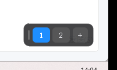

# 桌面切换面板 · Desktop Switcher Panel

一个常驻托盘的 Windows 悬浮小面板，**点数字直达任意虚拟桌面**——无切换动画、不抢焦点、可配全局热键。

Windows 原生的 `Win + Ctrl + ←/→` 只能逐个切换、带过渡动画，还容易切过头。
这个面板把桌面排成一行数字，想跳哪个就点哪个；按 `Alt+2` 直接到第 2 个桌面，中间不经过任何过渡。



> 基于 PyQt5 + [VirtualDesktopAccessor.dll](https://github.com/Lej77/VirtualDesktopAccessor)（MIT），
> 通过 Windows 未公开的虚拟桌面 COM 接口实现，不依赖 AutoHotkey。

## 特性

- **一键直达**：点数字 / `Alt+N` 瞬时切换到第 N 个桌面，无动画
- **不抢焦点**：点击面板不会把当前窗口推到后台，所以「把窗口移过去」能命中正确的窗口
- **跨桌面搬窗口**：右键数字可把当前窗口移过去（人留在原地，或跟着一起过去）
- **管理桌面**：新建、重命名、删除虚拟桌面都在面板上完成
- **自动同步**：用系统原生快捷键切换时，面板高亮和托盘图标会自动跟上
- **紧凑模式**：平时折叠成一枚显示当前桌面号的小药丸，鼠标悬停自动展开
- **深浅主题 / 不透明度可调**，位置记忆，开机自启
- **单实例互斥**，重复启动不会出现两个面板

## 环境要求

| 项目 | 要求 |
|---|---|
| 系统 | Windows 11 24H2（Build 26100.2605）及以上；已在 25H2 Build 26200 验证 |
| Python | 3.10+（开发用 3.13） |
| 依赖 | PyQt5（见 `requirements.txt`） |

## 安装与运行

```bash
git clone https://github.com/volador9/desktop-switcher-panel.git
cd desktop-switcher-panel
pip install -r requirements.txt

python main.py       # 调试启动，保留控制台输出
run.bat              # 后台启动，无控制台窗口
```

首次运行会自动贴到屏幕右下角，位置和设置保存在 `%APPDATA%\DesktopSwitcherPanel\config.json`。

也可以先跑一次自检确认 DLL 在当前系统上可用：

```bash
python selftest.py
```

## 使用说明

### 面板

| 操作 | 效果 |
|---|---|
| 左键数字 | 切到该桌面 |
| 右键数字 | 菜单：移当前窗口过来 / 移过来并跟过去 / 重命名桌面 / 删除桌面 |
| 左键按住拖动 | 移动面板位置，松手后自动记住 |
| 点 `＋` | 新建一个虚拟桌面 |
| 面板空白处右键 | 打开设置菜单 |
| 托盘图标单击 | 显示 / 隐藏面板 |

### 全局热键

| 按键 | 作用 |
|---|---|
| `Alt + 1..9` | 切到第 N 个桌面 |
| `Ctrl + Alt + 1..9` | 把当前窗口移到第 N 个桌面（人留在原地） |
| `` Alt + ` `` | 返回上一个桌面 |

热键可在托盘菜单里整体关闭。若某个组合已被其它软件占用，程序会弹出提示列出占用项，面板点击不受影响。

### 托盘菜单

显示/隐藏面板、紧凑模式、主题（深色/浅色）、不透明度、系统切换动画开关、
全局热键开关、开机自启、快捷键说明、退出。

## 打包为单文件 exe

```bash
build.bat
# 产物：dist\DesktopSwitcherPanel.exe
```

`build.bat` 会把 `VirtualDesktopAccessor.dll` 一并打进 exe。

## 项目结构

| 文件 | 说明 |
|---|---|
| `main.py` | 入口：单实例互斥、托盘、开机自启、信号接线 |
| `panel.py` | 悬浮面板 UI（不抢焦点、轮询同步、拖动、右键菜单） |
| `hotkeys.py` | 全局热键：`RegisterHotKey` + Qt 原生事件过滤器 |
| `vda.py` | `VirtualDesktopAccessor.dll` 的 ctypes 封装 |
| `config.py` | 配置读写 |
| `selftest.py` | DLL 可用性自检 |
| `tools/fetch_dll.py` | 从上游 release 拉取 / 更新 DLL |
| `tools/capture_panel.py` | 开发期截图小工具 |

## 已知限制

- 面板在**独占全屏**的游戏画面上不会置顶（无边框窗口化、远程串流场景正常）。
- Windows 大版本更新可能使 DLL 依赖的未公开接口失效；届时重新下载 DLL 即可：
  `python tools/fetch_dll.py`
- 未在 Windows 10 上测试。

## 许可

本项目以 MIT 许可开源，见 [LICENSE](LICENSE)。
随附的 `VirtualDesktopAccessor.dll` 为第三方组件，同样采用 MIT 许可，
版权与许可全文见 [THIRD_PARTY_NOTICES.md](THIRD_PARTY_NOTICES.md)。

---

## English

A tiny tray-resident floating panel for Windows that lets you **jump straight to any virtual desktop by clicking its number** — no switch animation, no focus stealing, optional global hotkeys.

Native `Win + Ctrl + ←/→` only steps one desktop at a time, animates, and overshoots easily. This panel lays your desktops out as a row of numbers: click the one you want, or hit `Alt+2` to land on desktop 2 directly.

**Features**

- Instant, animation-free jumps to desktop N (click or `Alt + 1..9`)
- Panel never takes focus, so "move this window over there" targets the right window
- Move the active window to any desktop (`Ctrl + Alt + 1..9`), with or without following it
- Create / rename / delete virtual desktops from the context menu
- Stays in sync when you switch with native shortcuts
- Compact pill mode, dark/light themes, adjustable opacity, position memory, autostart
- Single-instance guard

**Requirements**: Windows 11 24H2 (Build 26100.2605)+ · Python 3.10+ · PyQt5

**Run**

```bash
pip install -r requirements.txt
python main.py      # or run.bat for a console-less launch
```

Settings live in `%APPDATA%\DesktopSwitcherPanel\config.json`.

**Build a single exe**: `build.bat` → `dist\DesktopSwitcherPanel.exe`

**License**: MIT. Bundles [VirtualDesktopAccessor.dll](https://github.com/Lej77/VirtualDesktopAccessor) (MIT) — see [THIRD_PARTY_NOTICES.md](THIRD_PARTY_NOTICES.md).
